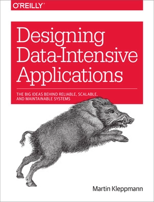

[Architect](../../README.md) / [BISTEC Training](../README.md)

# Senior Engineer Track - BISTEC

[Senior Engineer Track - Training Materials - Bistec Global - Process Documentation](https://process.bistecglobal.com/academy/role-based-training/senior-engineer-track/)

**Month 1: Advanced System Design**

[Design a URL Shortener (Bitly) - System Design Interview](https://youtu.be/qSJAvd5Mgio)

[Bitly: Lessons Learned Building a Distributed System that Handles 6 Billion Clicks a Month - High Scalability -](https://highscalability.com/bitly-lessons-learned-building-a-distributed-system-that-han/)

[Building a Scalable URL Shortener: A Complete System Design Guide](https://ayoushchourasia.medium.com/building-a-scalable-url-shortener-a-complete-system-design-guide-59c173c09eb9)

[URL Shortener System Design: From Basic to Advanced](https://www.youtube.com/watch?v=uL5pSfYYspg)

[What Is the CAP Theorem? \| IBM](https://www.ibm.com/think/topics/cap-theorem)

[Sharding vs Partitioning: Understanding Database Distribution Methods](https://www.datacamp.com/blog/sharding-vs-partitioning)

[Database Sharding — PlanetScale](https://planetscale.com/blog/database-sharding)

- 📄 [System Design](system-design.md)
