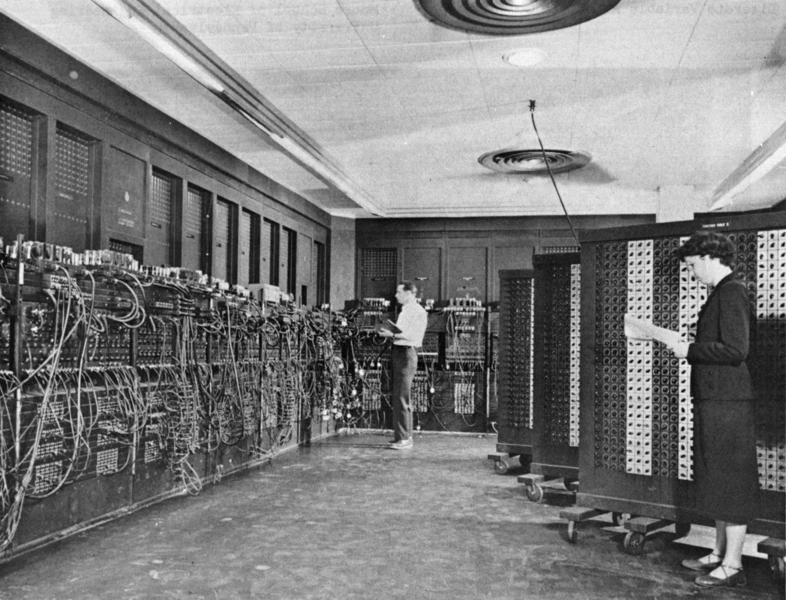
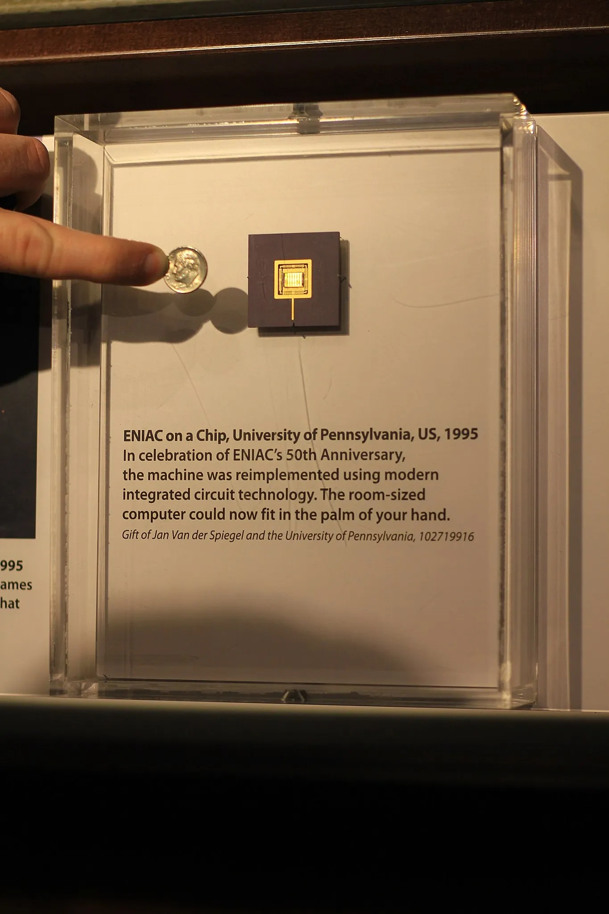

[Architect](../../../README.md) / [To be Organized](../../README.md) / [Notes](../README.md) / [CPU Architecture](README.md)

# ENIAC - 1945

ENIAC - **Electronic Numerical Integrator and Computer**

First programmable, electronic, general-purpose, digital computer.

It was [Turing-complete](https://en.wikipedia.org/wiki/Turing-complete) and able to solve "a large class of numerical problems" through reprogramming. The purpose the ENIAC designed for was to calculate artillery firing tables for US Army. However it’s first program was study of the feasibility of the thermonuclear weapon.

ENIAC was a program-controlled-computer, meaning that an operator programmed the computer with a set of switches and wires for each new calculation.

By the end of its operation in 1956, ENIAC contained 18,000 vacuum tubes, 7,200 crystal diodes, 1,500 relays, 70,000 resistors, 10,000 capacitors, and approximately 5,000,000 hand-soldered joints.  It weighed 27 Tons. It was 2m tall, 1m deep, 100m long device. Consumed 150 kW of electricity.

IO was punch cards. ENIAC had no system to store memory in its inception, these punch cards could be used for external memory storage. Later 100-[word](https://en.wikipedia.org/wiki/Word_(computer_architecture)) [magnetic-core memory](https://en.wikipedia.org/wiki/Magnetic-core_memory) built by the [Burroughs Corporation](https://en.wikipedia.org/wiki/Burroughs_Corporation) was added to ENIAC.  In 1996, in honor of the ENIAC's 50th anniversary, The University of Pennsylvania sponsored a project named "ENIAC-on-a-Chip”. A silicon chip 7.44mm x 5.29mm was built with same functionality as ENIAC. This 20 MHz chip was many times faster than ENIAC, although it had a fractional speed of it’s contemporary microprocessors in late 1990s.

Links: [ENIAC Display \| Computer Science & Engineering at Michigan](https://cse.engin.umich.edu/about/history/eniac-display/) [ENIAC](https://en.wikipedia.org/wiki/ENIAC) 

