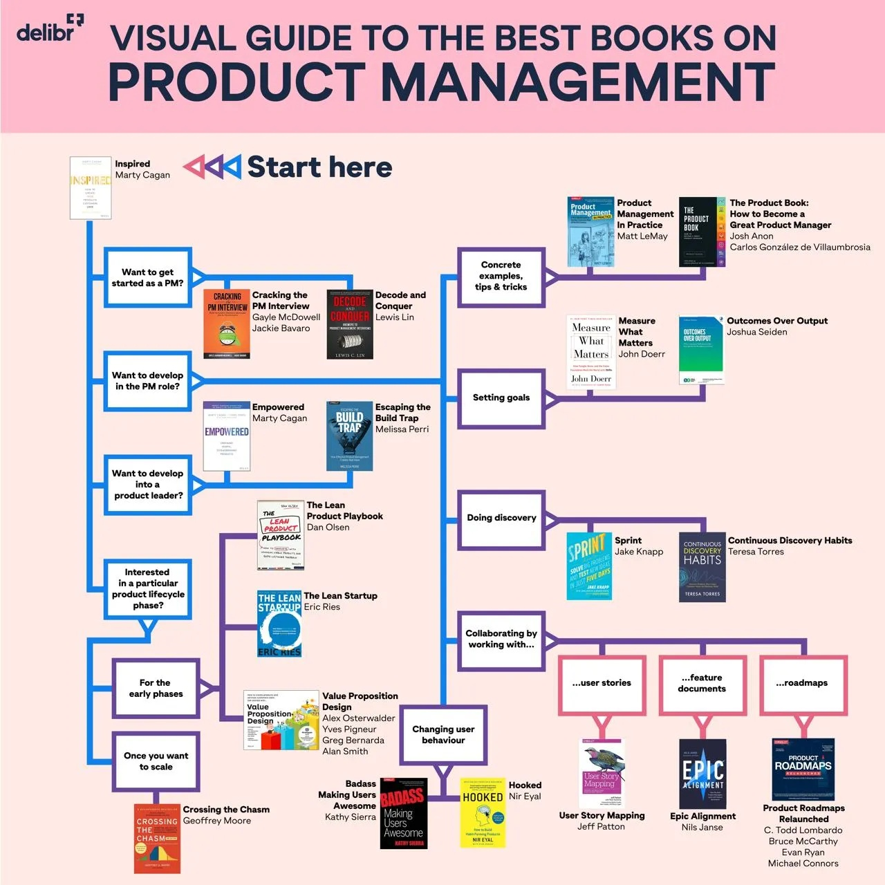

[Architect](../README.md)

# Topics

- 📄 [Auth](auth.md)
- 📄 [LLM](llm.md)
- 📄 [AI ML](ai-ml.md)
- 📄 [Programing Languages](programing-languages/README.md)
- 📄 [Database](database.md)
- 📄 [Data Structure & Algorithms](data-structure-and-algorithms.md)
- 📄 [Web](web.md)
- 📄 [Software Architecture](software-architecture.md)
- 📄 [Personal Brand Building](personal-brand-building.md)
- 📄 [Branding / Marketing / Sales](branding-marketing-sales.md)
- 📄 [Public Speaking](public-speaking/README.md)
- 📄 [YouTube Content Creation](youtube-content-creation.md)

## Proxy / Reverse Proxy

[Proxy vs Reverse Proxy vs Load Balancer \| Simply Explained](https://youtu.be/xo5V9g9joFs)

## Cloud

Learn Azure

## Containerization

- [ ] **Understanding Container Internals** [https://www.youtube.com/live/9ivFrXgB2Zg](https://www.youtube.com/live/9ivFrXgB2Zg)
- [ ] **Full NGINX Tutorial - Demo Project with Node.js, Docker** [Full NGINX Tutorial - Demo Project with Node.js, Docker](https://youtu.be/q8OleYuqntY)

## Networking

- [ ] **OSI Model Layer 1 - Physical** [https://youtu.be/YE0S91xc64I](https://youtu.be/YE0S91xc64I)
- [ ] **How TCP really works** [https://youtu.be/rmFX1V49K8U](https://youtu.be/rmFX1V49K8U)

## Agile

- [ ] **A lightweight talk about clean agile by Robert Martin** [https://youtu.be/Qp3h9ETZWUo](https://youtu.be/Qp3h9ETZWUo)
- [ ] **Spotify Model** [https://youtu.be/Yvfz4HGtoPc](https://youtu.be/Yvfz4HGtoPc) [https://youtu.be/vOt4BbWLWQw](https://youtu.be/vOt4BbWLWQw)  

> Agile is not a process, not a product, not a checklist, not a ritual.  Agile is a mindset. Agile is about thrust, autonomy, and culture. [https://www.linkedin.com/posts/andrebaken1_transformation-activity-7264715050232205312-Smf2](https://www.linkedin.com/posts/andrebaken1_transformation-activity-7264715050232205312-Smf2)

## Human Behavioral Biology

- [ ] **BIO 150: Human Behavioral Biology (BIO 250, HUMBIO 160) at Stanford by Prof. Robert Sapolsky.** [https://youtu.be/NNnIGh9g6fA](https://youtu.be/NNnIGh9g6fA)

## Human Brain

- [ ] **MIT 9.13 The Human Brain, Spring 2019 at MIT by Prof. Nancy Kanwisher** [https://youtu.be/ba-HMvDn_vU](https://youtu.be/ba-HMvDn_vU)

## Laws of Power

- [ ] **Machiavelli - The Art of Power in The Modern World** [https://youtu.be/Y7ExXLcy26s](https://youtu.be/Y7ExXLcy26s)
- [ ] **\[Book\] 48 Rules of Power by Robert Greene**

## Better Living

- [ ] **A Day in Life of Lex Fridman** [https://medium.com/@gayashan4lk/lex-fridmans-a-day-in-life-b898a148afb9](https://medium.com/@gayashan4lk/lex-fridmans-a-day-in-life-b898a148afb9)
- [ ] **40 Harsh truths** [https://youtu.be/lwmVAWXQyY4](https://youtu.be/lwmVAWXQyY4)
- [ ] **How to Become Undefeatable (Stoic Philosophy)** [https://youtu.be/dJwU3pjfUqo](https://youtu.be/dJwU3pjfUqo)
- [ ] **Once You Stop Caring, Results Come** [https://youtu.be/VpcQVjSVqOM](https://youtu.be/VpcQVjSVqOM)

---

## Design/ UI UX

- [ ] Figma Learn  www.figma.com/learn
- [ ] Learn Design Basics [https://www.figma.com/resource-library/design-basics/](https://www.figma.com/resource-library/design-basics/)
- [ ] Shadcn [Nextjs 14 & Shadcn](https://www.youtube.com/playlist?list=PL8HkCX2C5h0VGhZnfbwf2hq7yD7nXMbJJ)
- [ ] **How to make your website responsive** [How to make your website responsive](https://youtu.be/vQDgoQKfdzM)
- [ ] Figma tutorial for beginners [Figma Tutorial for Beginners (2024): Website Design](https://youtu.be/clSHs94hNNc)
- [ ] The ultimate guide to Typography [The Ultimate Guide to Typography \| FREE COURSE](https://youtu.be/yAuUDyUC-GM)
- [ ] How to choose fonts [How to choose fonts: Step by step](https://youtu.be/WTUM2Y11oJo)
- [ ] Only 6 fonts you need [The only 6 fonts web designers need (and they’re free!)](https://youtu.be/LPHXeKz7p0s)
- [ ] Only 6 fonts you need [Designers Only Need These 6 Fonts. Trash the Rest.](https://youtu.be/_4cW79vF1mU)
- [ ] Framer Crash Course [Learn Framer in 20 Minutes (Crash Course)](https://youtu.be/P5H7zs0RsUM)
- [ ] 📕 The Vignelli Canon Book [The Vignelli Canon : Vignelli, Massimo](https://archive.org/details/thevignellicanon)
- [ ] Make a simple web site [Best and fastest way to design beautiful websites](https://youtu.be/OZ_tBExnuX8)
- [ ] [Why Beautiful Websites Don’t Convert](https://youtu.be/Toonu-cTE60)
- [ ] [How websites convert into sales?](https://youtu.be/aGTqFp7GAKE)

[Typography for Developers Tutorial - Full Course](https://youtu.be/agbh1wbfJt8)

 [Designers Only Need These 6 Fonts. Trash the Rest.](https://youtu.be/_4cW79vF1mU)

[The 80% of UI Design - Typography](https://youtu.be/9-oefwZ6Z74)

[The Anatomy of Typography for Graphic Designers](https://youtu.be/DnscuBj4eGM)

[The 80% of UI Design - Typography](https://youtu.be/9-oefwZ6Z74)

[The Easy Way to Design Top Tier Websites](https://youtu.be/qyomWr_C_jA)

[The ULTIMATE Guide To Typography For Beginners](https://youtu.be/AXpxZMRM1EY)

[Typography Tutorial - 10 rules to help you rule type](https://youtu.be/QrNi9FmdlxY)

[5 Exercises That WILL Make You A Better Designer](https://youtu.be/LercGDxFaWg)

[Shantanu Kumar](https://www.youtube.com/@ShantanuKumar/videos)

[Our Startup's New Design System! w/ Designer & Dev](https://youtu.be/dLejpNs4aeY)

[The Easy Way to Pick UI Colors](https://youtu.be/vvPklRN0Tco)

### Principles of Layout

- [ ] **Complete Layout Guide (Principles of Layout: Pt 1 of 3)** [Complete Layout Guide](https://youtu.be/MlsV3hu84as)
- [ ] **Grouping, Scale, and Sequence (Principles of Layout: Pt 2 of 3)** [Grouping, Scale, and Sequence (Principles of Layout: Pt 2 of 3)](https://youtu.be/_Pp0JHEswMk)
- [ ] **Alignment, Balance, and Grids (Principles of Layout: Pt 3 of 3)** [Alignment, Balance, and Grids (Principles of Layout: Pt 3 of 3)](https://youtu.be/DP9Bzd4_-NM)
- [ ] **The missing guide to grids** [The missing guide to grids](https://youtu.be/wIabVp0Hh8U)

### Mobile first design

[Should web design be mobile-first?](https://youtu.be/g1jKx6rpydk)

[This is what mobile web design excellence looks like](https://youtu.be/1r4GHOd2THM)

### Next.js Image

[Next.js Image Optimization with Image Component \| Responsive Images](https://youtu.be/gpJKj45AikY)

[Using Images in Next.js (next/image examples)](https://youtu.be/IU_qq_c_lKA)

[How To Load Images Like A Pro](https://youtu.be/hJ7Rg1821Q0)

### Tailwind

[Learn Tailwind CSS – Course for Beginners](https://youtu.be/ft30zcMlFao)

[Colors with Tailwindcss — Course Part 1](https://youtu.be/KFtM4tuCTZs)

### ShadCN

[How To Actually Use ShadCN/UI](https://youtu.be/3tIpgRwKWEs)

### Web Design Inspiration

[https://www.awwwards.com/websites/](https://www.awwwards.com/websites/)

[https://www.siteinspire.com](https://www.siteinspire.com/)

### Cool web sites

[https://www.ntgent.be/en](https://www.ntgent.be/en)

[https://www.tabasco.com](https://www.tabasco.com/)

[https://www.makingsoftware.com](https://www.makingsoftware.com/)

[NTGent \| Web Design Inspiration \| Siteinspire](https://www.siteinspire.com/website/13294-ntgent)

[https://ethereum.org](https://ethereum.org/)

---

## Computer Architecture

- [ ] Building a 8-bit computer [https://youtube.com/playlist?list=PLowKtXNTBypGqImE405J2565dvjafglHU](https://youtube.com/playlist?list=PLowKtXNTBypGqImE405J2565dvjafglHU)
- [ ] **How does an OS boot? //Source Dive// 001** [How does an OS boot? //Source Dive// 001](https://youtu.be/KkenLT8S9Hs)

## Product Development

- [ ] **\[Book\] Inspired by Marty Cagan**
- [ ] **Making sense of MVP** [https://youtu.be/0P7nCmln7PM](https://youtu.be/0P7nCmln7PM)

## Leadership

## Learning

- [ ] **How To Self Study AI FAST** [https://youtu.be/0zi-CG_iB6w](https://youtu.be/0zi-CG_iB6w) 
- [ ] **How To Train Yourself To Become A Genius** [https://youtu.be/TT-w0-obo44](https://youtu.be/TT-w0-obo44) 
- [ ] **10 Principles To Learn Anything** [https://youtu.be/QqLEfZXPdU4](https://youtu.be/QqLEfZXPdU4) 
- [ ] **There's no such thing as MIRACLE, Richard Feynman advice to students \| self-improvement video** [https://youtu.be/bAX27XRHMH8](https://youtu.be/bAX27XRHMH8) 
- [ ] **Feynman Technique For High School and College Students** [https://youtu.be/JmhfOjuAaew](https://youtu.be/JmhfOjuAaew) 
- [ ] **How to Take Notes for Technical Things** [https://youtu.be/jd9lEAqkp9Y](https://youtu.be/jd9lEAqkp9Y)

## Math

- [ ] **Probability Top 10 Must Knows** [Probability Top 10 Must Knows (ultimate study guide)](https://youtu.be/LgLgexX7iTs)

## Personal Finance

- [ ] [How I Track My Money - The System That's Making Me A Millionaire](https://youtu.be/DCcqUaV8TVo)

## Thinking

### Systems Thinking

- [ ] [Tools for Systems Thinkers: The 6 Fundamental Concepts of Systems Thinking](https://medium.com/disruptive-design/tools-for-systems-thinkers-the-6-fundamental-concepts-of-systems-thinking-379cdac3dc6a)
- [ ] [Unlocking the Power of Systems Thinking \| by Leyla Acaroglu \| Disruptive Design \| Medium](https://medium.com/disruptive-design/unlocking-the-power-of-systems-thinking-b3809eaab519)

### Design Thinking

- [ ] [The Designer's Full Stack Manifesto \[Episode 1\]](https://youtu.be/zuMbbLYRBxU)
- [ ] [The Full Stack Deisgner Manifesto](https://www.slideshare.net/slideshow/the-full-stack-deisgner-manifesto/49624053)

## What is serverless

- [ ] [Serverless: A Comprehensive Breakdown](https://youtu.be/_VQl_HTk9PM)
- [ ] In the old days when there there is no “serverless”… → XAMPP, LAMP, WAMP
- [ ] [Ryan Carniato](https://www.youtube.com/@ryansolid)
- [ ] AWS EC2 Instances  [Amazon EC2](https://aws.amazon.com/pm/ec2/)
- [ ] AWS Auto scaling groups [Auto Scaling groups - Amazon EC2 Auto Scaling](https://docs.aws.amazon.com/autoscaling/ec2/userguide/auto-scaling-groups.html)
- [ ] K8s [Production-Grade Container Orchestration](https://kubernetes.io/)

#### Search in google this “What is serverless” and you get…

- [ ] [What is serverless computing? \|  Serverless definition \| Cloudflare](https://www.cloudflare.com/learning/serverless/what-is-serverless/)
- [ ] [What is serverless?](https://www.redhat.com/en/topics/cloud-native-apps/what-is-serverless)
- [ ] [What Is Serverless Computing? \| IBM](https://www.ibm.com/think/topics/serverless)
- [ ] [What is Serverless Computing? - Serverless Computing Explained - AWS](https://aws.amazon.com/what-is/serverless-computing/)
- [ ] [What is serverless computing \| Google Cloud](https://cloud.google.com/discover/what-is-serverless-computing)
- [ ] [What Is Serverless?](https://www.oracle.com/lk/cloud/cloud-native/functions/what-is-serverless/)
- [ ] [Serverless Framework Concepts](https://www.serverless.com/framework/docs/providers/aws/guide/intro)
- [ ] [Serverless Architecture: What It Is & How It Works \| Datadog](https://www.datadoghq.com/knowledge-center/serverless-architecture/)
- [ ] [An Introduction to Serverless Architecture \| DigitalOcean](https://www.digitalocean.com/resources/articles/serverless-architecture)

## NextJs Authentication

- [ ] [Authentication Flow in Next.js (Complete Tutorial)](https://youtu.be/Otq0LY90Qso)
- [ ] [Next.js App Router Authentication (Sessions, Cookies, JWTs)](https://youtu.be/DJvM2lSPn6w)
- [ ] [Tutorial: NextJS Single Sign On Azure B2C](https://youtu.be/5uDMexiCUQ0)
- [ ] [Add Authentication to Next.js in 10 mins with OAuth (Google, Github...)](https://youtu.be/AbUVY16P4Ys)
- [ ] [Next-Auth V5 Tutorial (OAuth, Email, Server Actions, Server-Side Auth, Client-Side Auth, Roles)](https://youtu.be/bMYZSi_LZ2w)
- [ ] [Next-Auth Login Authentication Tutorial with Next.js App Directory](https://youtu.be/w2h54xz6Ndw)
- [ ] [NextJS 15 Authentication Tutorial - Learn Next-Auth in 30 Minutes](https://youtu.be/n-fVrzaikBQ)

## Cursor / WindSurf

- [ ] [Windsurf vs Cursor: which is the better AI code editor?](https://youtu.be/9jgR-Ih_wGs)
- [ ] [I spent 400+ hours in Cursor, here’s what I learned](https://youtu.be/gYLNxUxVomY)
- [ ] [How to use Cursor Agent for beginners](https://youtu.be/2gBcO3ht0ws)
- [ ] [Cursor AI tutorial for beginners](https://youtu.be/gqUQbjsYZLQ)

## Clean Architecture

> ⚠️ Embedded content not exported — [view in Notion](https://www.notion.so/b447e6f2f1fe4a9a88f24a0bd3e9a4dc#19cebef13b8480c7bbefe07bc1647d95)

- [ ] [What is Clean Architecture?](https://newsletter.techworld-with-milan.com/p/what-is-clean-architecture)
- [ ] [Clean Architecture & DDD Series](https://www.youtube.com/playlist?list=PLYpjLpq5ZDGstQ5afRz-34o_0dexr1RGa)
- [ ] [Learn Clean Architecture & Domain-Driven Design](https://www.youtube.com/playlist?list=PLYpjLpq5ZDGv370qMB4PLF-PlGdBhP0PA)

## Linux

- [ ] [Learn Linux - Full Course Walkthrough](https://youtu.be/v392lEyM29A)
- [ ] [100+ Linux Things you Need to Know](https://youtu.be/LKCVKw9CzFo)

## System Design

- [ ] [System Design was HARD until I Learned these 30 Concepts](https://youtu.be/s9Qh9fWeOAk)

## Kubernetes

- [ ] [Kubernetes 101: Deploying Your First Application!](https://youtu.be/XltFOyGanYE)
- 📄 [Mobile](mobile.md)

## .NET Aspire

[.NET Aspire 9.2 is out and it's amazing! NEW RESOURCE GRAPH](https://youtu.be/QvSDRRGv8cs)

## Next.js

[NextJS + Postgres and Error Monitoring  - Full Stack Support Ticketing System](https://youtu.be/NKiTlo_dgb8)

- 📄 [SwiftUI](swiftui.md)
- 📄 [Startups](startups.md)
- 📄 [Power Platform](power-platform.md)
- 📄 [AI Coding Tools](ai-coding-tools.md)
- 📄 [AI Software Engineer Roadmap](ai-software-engineer-roadmap.md)
